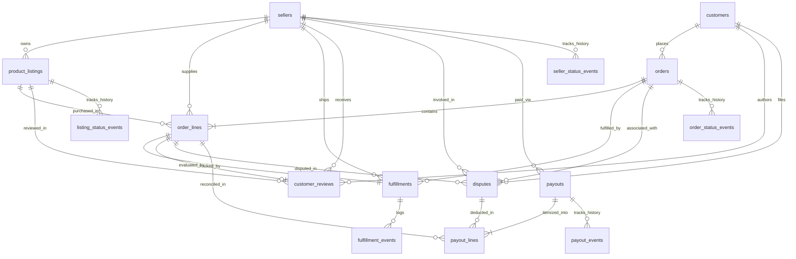

# Database Architecture & Data Dictionary

## 1. Entity-Relationship (ER) Diagram

---

## 2. Core Entities Data Dictionary

### Table: `sellers`
| Column | Type | Nullable | Key / Constraint | Description |
|---|---|---|---|---|
| `seller_id` | VARCHAR(32) | NO | PK | Deterministic ID (e.g. `SELL-000001`) |
| `name` | VARCHAR(120) | NO | | Legal / display business name |
| `email` | VARCHAR(120) | NO | UNIQUE | Primary seller contact email |
| `phone` | VARCHAR(32) | YES | | Contact phone number |
| `status` | ENUM | NO | INDEX | `ACTIVE`, `SUSPENDED`, `UNDER_REVIEW`, `TERMINATED` |
| `rating` | DECIMAL(3,2) | NO | | Average customer satisfaction rating (1.00 - 5.00) |
| `on_time_shipment_rate` | DECIMAL(5,2) | NO | | Percentage of orders shipped on time |
| `fulfillment_rate` | DECIMAL(5,2) | NO | | Percentage of ordered items fulfilled |
| `cancellation_rate` | DECIMAL(5,2) | NO | | Percentage of orders cancelled by seller |
| `return_rate` | DECIMAL(5,2) | NO | | Percentage of delivered items returned |
| `dispute_rate` | DECIMAL(5,2) | NO | | Percentage of orders disputed |
| `reserve_rate` | DECIMAL(5,4) | NO | | Rolling reserve retention percentage (e.g. 0.1000 = 10%) |
| `created_at` | DATETIME | NO | | Record creation timestamp |
| `updated_at` | DATETIME | NO | | Record update timestamp |

---

### Table: `product_listings`
| Column | Type | Nullable | Key / Constraint | Description |
|---|---|---|---|---|
| `listing_id` | VARCHAR(48) | NO | PK | Deterministic ID (e.g. `LIST-SELL-000001-000001`) |
| `seller_id` | VARCHAR(32) | NO | FK -> `sellers.seller_id` | Owning seller |
| `sku` | VARCHAR(64) | NO | | Seller Stock Keeping Unit |
| `title` | VARCHAR(200) | NO | | Listing title |
| `category` | VARCHAR(80) | NO | INDEX | Product category |
| `price` | DECIMAL(12,2) | NO | | Unit listing price |
| `stock_quantity` | INT | NO | | Available inventory count |
| `status` | ENUM | NO | INDEX | `ACTIVE`, `INACTIVE`, `DELISTED` |
| `created_at` | DATETIME | NO | | Creation timestamp |
| `updated_at` | DATETIME | NO | | Update timestamp |

---

### Table: `customers`
| Column | Type | Nullable | Key / Constraint | Description |
|---|---|---|---|---|
| `customer_id` | VARCHAR(32) | NO | PK | Deterministic ID (e.g. `CUST-000001`) |
| `name` | VARCHAR(120) | NO | | Customer full name |
| `email` | VARCHAR(120) | NO | UNIQUE | Customer email address |
| `phone` | VARCHAR(32) | YES | | Contact telephone |
| `shipping_address`| VARCHAR(255) | NO | | Delivery street address |
| `city` | VARCHAR(80) | NO | | Delivery city |
| `state` | VARCHAR(80) | NO | | Delivery state |
| `postal_code` | VARCHAR(20) | NO | | Postal code / PIN |
| `created_at` | DATETIME | NO | | Account creation timestamp |

---

### Table: `orders`
| Column | Type | Nullable | Key / Constraint | Description |
|---|---|---|---|---|
| `order_id` | VARCHAR(32) | NO | PK | Deterministic ID (e.g. `ORD-2026-000001`) |
| `customer_id` | VARCHAR(32) | NO | FK -> `customers.customer_id` | Purchasing customer |
| `order_date` | DATETIME | NO | INDEX | Timestamp order placed |
| `order_status` | ENUM | NO | INDEX | `PLACED`, `PROCESSING`, `PARTIALLY_SHIPPED`, `SHIPPED`, `DELIVERED`, `CANCELLED`, `RETURNED` |
| `payment_status` | ENUM | NO | | `PAID`, `PENDING`, `FAILED`, `REFUNDED` |
| `total_gross_amount` | DECIMAL(12,2)| NO | | Total gross customer paid |
| `shipping_fee` | DECIMAL(10,2)| NO | | Shipping fee charged |
| `tax_amount` | DECIMAL(10,2)| NO | | Sales tax charged |
| `created_at` | DATETIME | NO | | Record creation timestamp |
| `updated_at` | DATETIME | NO | | Record update timestamp |

---

### Table: `order_lines`
| Column | Type | Nullable | Key / Constraint | Description |
|---|---|---|---|---|
| `order_line_id` | VARCHAR(48) | NO | PK | Deterministic ID (e.g. `ORD-2026-000001-01`) |
| `order_id` | VARCHAR(32) | NO | FK -> `orders.order_id` | Parent order reference |
| `listing_id` | VARCHAR(48) | NO | FK -> `product_listings.listing_id` | Product listing reference |
| `seller_id` | VARCHAR(32) | NO | FK -> `sellers.seller_id` | Individual item seller (enables multi-seller order splitting) |
| `quantity` | INT | NO | | Purchased quantity |
| `unit_price` | DECIMAL(12,2)| NO | | Price per unit at purchase |
| `line_total` | DECIMAL(12,2)| NO | | Subtotal (`quantity * unit_price`) |
| `commission_rate`| DECIMAL(5,4) | NO | | Effective commission rate applied |
| `commission_amount`| DECIMAL(12,2)| NO | | Total commission deducted for line |
| `status` | ENUM | NO | INDEX | `PENDING`, `PROCESSING`, `SHIPPED`, `DELIVERED`, `CANCELLED`, `RETURNED` |
| `created_at` | DATETIME | NO | | Line creation timestamp |

---

### Table: `fulfillments`
| Column | Type | Nullable | Key / Constraint | Description |
|---|---|---|---|---|
| `fulfillment_id` | VARCHAR(48) | NO | PK | Deterministic ID (`FUL-<order-line-id>`) |
| `order_line_id` | VARCHAR(48) | NO | FK -> `order_lines.order_line_id`, UNIQUE | 1:1 fulfillment tracking per line |
| `order_id` | VARCHAR(32) | NO | FK -> `orders.order_id` | Parent order reference |
| `seller_id` | VARCHAR(32) | NO | FK -> `sellers.seller_id` | Fulfilling seller |
| `tracking_number`| VARCHAR(80) | NO | UNIQUE | Carrier airway bill / tracking number |
| `carrier` | VARCHAR(64) | NO | | Logistics carrier (FedEx, UPS, DHL, BlueDart) |
| `status` | ENUM | NO | INDEX | `AWAITING_PICKUP`, `IN_TRANSIT`, `OUT_FOR_DELIVERY`, `DELIVERED`, `DELAYED`, `RETURNED`, `FAILED` |
| `shipped_at` | DATETIME | YES | | Actual departure timestamp |
| `estimated_delivery` | DATETIME | YES | | Target delivery timestamp |
| `delivered_at` | DATETIME | YES | | Actual delivery timestamp |
| `is_delayed` | BOOLEAN | NO | INDEX | True if delivered after estimated date |
| `delay_days` | INT | NO | | Days elapsed past estimated delivery |

---

### Table: `customer_reviews`
| Column | Type | Nullable | Key / Constraint | Description |
|---|---|---|---|---|
| `review_id` | VARCHAR(32) | NO | PK | Deterministic ID (e.g. `REV-2026-000001`) |
| `order_line_id` | VARCHAR(48) | NO | FK, UNIQUE | Associated order line |
| `seller_id` | VARCHAR(32) | NO | FK | Evaluated seller |
| `listing_id` | VARCHAR(48) | NO | FK | Evaluated product listing |
| `customer_id` | VARCHAR(32) | NO | FK | Author customer |
| `rating` | INT | NO | | Rating scale 1 to 5 |
| `comment` | TEXT | YES | | Feedback textual review |
| `created_at` | DATETIME | NO | | Review publication timestamp |

---

### Table: `disputes`
| Column | Type | Nullable | Key / Constraint | Description |
|---|---|---|---|---|
| `dispute_id` | VARCHAR(32) | NO | PK | Deterministic ID (e.g. `DSP-2026-000001`) |
| `order_id` | VARCHAR(32) | NO | FK | Disputed order reference |
| `order_line_id` | VARCHAR(48) | NO | FK | Specific item disputed |
| `seller_id` | VARCHAR(32) | NO | FK | Respondent seller |
| `customer_id` | VARCHAR(32) | NO | FK | Claimant customer |
| `dispute_type` | ENUM | NO | | `ITEM_NOT_RECEIVED`, `DAMAGED_ITEM`, `WRONG_ITEM`, `UNAUTHORIZED_CHARGE`, `DEFECTIVE_PRODUCT` |
| `status` | ENUM | NO | INDEX | `OPEN`, `UNDER_INVESTIGATION`, `RESOLVED_SELLER_FAVOR`, `RESOLVED_CUSTOMER_FAVOR`, `CHARGEBACK_LOST`, `CANCELLED` |
| `claim_amount` | DECIMAL(12,2)| NO | | Disputed monetary claim |
| `deduction_amount`| DECIMAL(12,2)| NO | | Amount deducted from seller payout |
| `resolution_date`| DATETIME | YES | | Dispute closure date |

---

### Table: `commission_rules`
| Column | Type | Nullable | Key / Constraint | Description |
|---|---|---|---|---|
| `rule_id` | VARCHAR(32) | NO | PK | Deterministic ID (e.g. `RULE-2026-000001`) |
| `category` | VARCHAR(80) | NO | INDEX | Applicable listing category |
| `base_rate` | DECIMAL(5,4) | NO | | Fee percentage (e.g. 0.0800 = 8%) |
| `min_commission`| DECIMAL(10,2)| NO | | Floor charge per transaction |
| `max_commission`| DECIMAL(10,2)| YES | | Ceiling charge per transaction |
| `effective_from`| DATETIME | NO | INDEX | Effective validity start |
| `effective_to` | DATETIME | YES | INDEX | Effective validity expiry |
| `is_active` | BOOLEAN | NO | | Active state flag |

---

### Table: `payouts`
| Column | Type | Nullable | Key / Constraint | Description |
|---|---|---|---|---|
| `payout_id` | VARCHAR(32) | NO | PK | Deterministic ID (e.g. `PAYOUT-2026-000001`) |
| `seller_id` | VARCHAR(32) | NO | FK | Recipient seller |
| `batch_reference`| VARCHAR(64) | NO | INDEX | Settlement batch tag |
| `payout_date` | DATETIME | NO | INDEX | Scheduled / disbursement timestamp |
| `status` | ENUM | NO | INDEX | `SCHEDULED`, `PROCESSING`, `HELD`, `PAID`, `FAILED`, `CANCELLED` |
| `gross_amount` | DECIMAL(12,2)| NO | | Total eligible gross revenue |
| `commission_deduction`| DECIMAL(12,2)| NO | | Total commissions withheld |
| `refund_deduction` | DECIMAL(12,2)| NO | | Total customer refunds deducted |
| `dispute_deduction`| DECIMAL(12,2)| NO | | Total dispute / chargeback debits |
| `reserve_hold_amount`| DECIMAL(12,2)| NO | | Rolling reserve escrow held |
| `adjustments` | DECIMAL(12,2)| NO | | Eligible credits / penalties |
| `net_payout_amount` | DECIMAL(12,2)| NO | | Net disbursement (`Gross - Comm - Refund - Dispute - Reserve + Adj`) |
| `reconciliation_status`| ENUM | NO | INDEX | `RECONCILED`, `DISCREPANCY`, `UNRECONCILED` |

---

### Table: `payout_lines`
| Column | Type | Nullable | Key / Constraint | Description |
|---|---|---|---|---|
| `payout_line_id` | VARCHAR(48) | NO | PK | Deterministic ID (e.g. `PAYLINE-2026-000001-01`) |
| `payout_id` | VARCHAR(32) | NO | FK | Parent payout batch header |
| `order_line_id` | VARCHAR(48) | YES | FK | Line item referenced |
| `dispute_id` | VARCHAR(32) | YES | FK | Dispute referenced |
| `line_type` | ENUM | NO | INDEX | `SALE`, `COMMISSION`, `REFUND`, `DISPUTE`, `RESERVE_HOLD`, `RESERVE_RELEASE`, `ADJUSTMENT` |
| `amount` | DECIMAL(12,2)| NO | | Line amount (signed: positive credit, negative debit) |
| `description` | VARCHAR(255) | YES | | Transaction memo |

